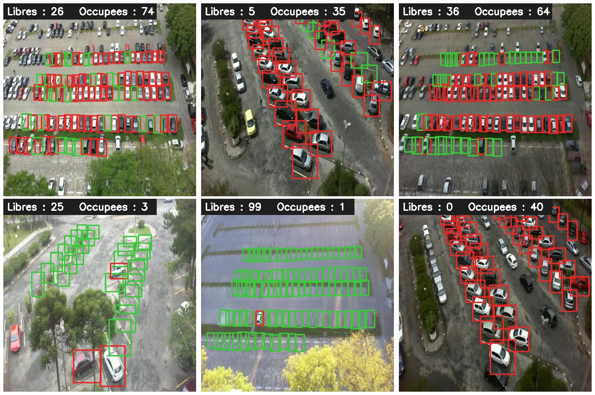
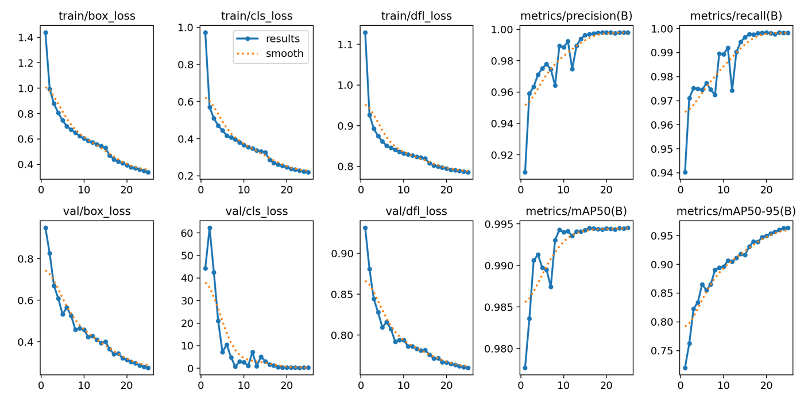

# 🅿️ Détection de places de parking libres et occupées (YOLOv8)

**Un modèle de vision par ordinateur qui repère chaque place d'un parking sur une image de caméra et indique si elle est libre ou occupée.**
Projet d'IA et de deep learning réalisé en groupe à l'ESIEE Paris.

*Parking space occupancy detection with YOLOv8 trained on the PKLot dataset (ESIEE Paris deep learning project).*


<p align="center">
  
  <br><em>Images du jeu de test, jamais vues pendant l'entraînement : places libres en vert, occupées en rouge.</em>
</p>

## Le problème

Trouver une place libre dans un grand parking fait perdre du temps et génère du trafic inutile. À partir d'une simple caméra de surveillance, le modèle :
1. **détecte** chaque place de parking visible sur l'image ;
2. **classe** chaque place en *libre* ou *occupée* ;
3. **compte** les places disponibles, ce qui pourrait alimenter un panneau d'affichage à l'entrée du parking.

## Données

[PKLot](https://web.inf.ufpr.br/vri/databases/parking-lot-database/) (Université Fédérale du Paraná, licence CC BY 4.0) : **12 416 images** de parkings prises par temps ensoleillé, nuageux et pluvieux, avec plus de 140 000 places annotées. Nous avons utilisé l'export Roboflow au format YOLO (images 640×640) :

| Jeu | Images |
|---|---|
| Entraînement | 8 690 |
| Validation | 2 483 |
| Test | 1 242 |

## Méthode

- **Modèle** : YOLOv8n (version « nano », 3 millions de paramètres) d'Ultralytics, pré-entraîné sur COCO puis ré-entraîné sur PKLot (*transfer learning*).
- **Entraînement** : 25 époques, images 640×640, batch de 16, optimiseur AdamW choisi automatiquement, sur un GPU Tesla T4 (Google Colab), environ 1 heure.
- **Approche comparée** : nous avions d'abord essayé un réseau convolutif Keras à deux sorties (une boîte + une classe par image). Il ne pouvait prédire qu'une seule place par image, alors qu'un parking en compte plusieurs dizaines. YOLO, qui détecte un nombre quelconque d'objets en une passe, est bien plus adapté.

## Résultats

Sur le **jeu de test** (images jamais vues pendant l'entraînement) :

| Précision | Rappel | mAP@50 | mAP@50-95 | Temps d'inférence |
|---|---|---|---|---|
| 0,997 | 0,997 | 0,994 | 0,968 | 4,4 ms par image (GPU T4) |

Le modèle se trompe très rarement et reste assez rapide pour analyser un flux vidéo en direct.

**Le compteur de places est-il juste ?** Pour un utilisateur, la vraie question est le nombre de places libres affiché. Sur les 1 242 images de test, en comparant le compte prédit au compte réel :

| Erreur moyenne (places libres) | Erreur moyenne (places occupées) | Images où le compte est exact | Pire image |
|---|---|---|---|
| 0,17 place par image | 0,14 place par image | 84 % | 20 places libres d'écart |

Le compteur se trompe donc d'environ une place toutes les six images. La pire image, avec 20 places d'écart, reste un cas isolé qu'il faudrait examiner pour comprendre l'erreur. Les pertes d'entraînement et de validation baissent ensemble pendant les 25 époques, sans remontée de la perte de validation : il n'y a pas de signe de surapprentissage.

<p align="center"></p>

Ces scores sont à relativiser : les caméras de PKLot sont fixes, donc les images de test viennent des mêmes parkings que celles d'entraînement. Sur un parking jamais vu, il faudrait s'attendre à des performances plus faibles (voir *Limites*).

## Utilisation

```bash
pip install -r requirements.txt

# une image, un dossier d'images ou une vidéo
python detect.py --source parking.jpg
python detect.py --source video.mp4
```

Le modèle entraîné est fourni dans `models/best.pt` (6 Mo). Le script enregistre les images annotées dans `resultats/` (places libres en vert, occupées en rouge) et affiche le nombre de places libres et occupées.

Pour ré-entraîner le modèle, ouvrir [`notebooks/parking_yolov8_pklot.ipynb`](notebooks/parking_yolov8_pklot.ipynb) dans Google Colab avec un GPU. Le notebook prépare les données, entraîne le modèle, l'évalue sur le jeu de test et génère les images de démonstration.

## Limites et pistes d'amélioration

- **Généralisation** : PKLot ne contient que trois points de vue de caméra. Pour un autre parking, il faudrait ajouter des images annotées de ce parking (ou un dataset plus varié comme CNRPark).
- **Places annotées seulement** : PKLot n'annote que certaines rangées de chaque parking, donc le modèle ne repère que ce type de places (les voitures dans les allées sont ignorées, ce qui est voulu).
- **Places partiellement visibles** : les places cachées par un arbre ou un véhicule voisin restent difficiles.
- **Temps réel** : avec moins de 5 ms par image, le modèle peut traiter un flux vidéo en direct ; une étape suivante serait de le déployer sur une carte embarquée (Raspberry Pi, Jetson).

## Équipe

Projet réalisé en groupe à l'ESIEE Paris : Bérénice Bettinger, Zoé Carruette, Nina Bouschbacher.

## Référence

Almeida, P., Oliveira, L. S., Silva Jr, E., Britto Jr, A., Koerich, A. *PKLot – A robust dataset for parking lot classification*. Expert Systems with Applications, 42(11):4937-4949, 2015.
